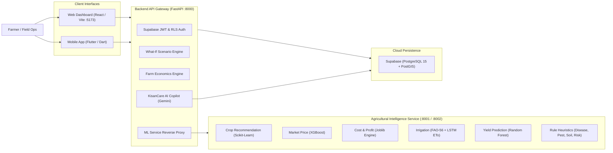

# KisanCare: AI-Powered Farm Digital Twin & Decision Intelligence

KisanCare is an agricultural decision-support platform designed for Indian smallholder and commercial farmers. It constructs a dynamic **Farm Digital Twin** combining field boundaries, soil chemistry, real-time weather, and crop rotation history to deliver predictive agronomic and financial intelligence.

---

## 1. System Architecture



The system executes the closed-loop decision lifecycle:
$$\text{OBSERVE} \longrightarrow \text{PREDICT} \longrightarrow \text{SIMULATE} \longrightarrow \text{COMPARE} \longrightarrow \text{DECIDE} \longrightarrow \text{LEARN}$$

---

## 2. Repository Directory Structure

```
kisan-care/
├── backend/                   # FastAPI API Gateway (Port 8000)
│   ├── app/
│   │   ├── api/               # Endpoint routers & ML proxy logic
│   │   ├── copilot/           # Gemini AI Copilot router & grounding service
│   │   ├── economics/         # Farm economics & gross margin calculator
│   │   └── simulation/        # What-If scenario perturbation engine
│   └── requirements.txt       # Backend dependencies
├── frontend/                  # React + TypeScript + Vite Web Dashboard (Port 5173)
│   ├── src/
│   │   ├── components/        # Layout, AppShell, sidebar, shared UI
│   │   ├── screens/           # 18 screen modules (FarmSetup, CropRec, Copilot, etc.)
│   │   └── services/          # API client (api.ts) & Supabase client
│   └── package.json           # Frontend dependencies & scripts
├── ml/                        # Agricultural ML Inference Microservice (Port 8001)
│   ├── crop_recommendation/   # MVP v2 prediction pipeline
│   ├── market_price/          # XGBoost models & Agmarknet inference
│   ├── rule_based/            # Domain heuristic engines
│   └── routers/               # /api/v1/models/ REST endpoints
├── mobile/                    # Flutter / Dart Cross-Platform Mobile Application
│   ├── lib/                   # Mobile screens, state, models, and API client
│   └── pubspec.yaml           # Flutter dependencies
├── models/                    # Trained model binaries and preprocessing encoders
│   ├── crop_recommendation/   # crop_recommendation_mvp_v2.pkl (81.4 MB)
│   └── model6_cost_profit/    # cost_model.joblib (400 KB)
├── services/                  # Standalone microservices
│   └── irrigation_yield_api/  # FAO-56 Water Balance + ETo LSTM + RF Crop Yield
├── supabase/                  # PostgreSQL DDL migrations & PostGIS tables
├── tests/                     # Automated integration and regression test suites
├── .env.example               # Safe configuration template
├── docker-compose.yml         # Container orchestration
└── requirements.txt           # Core ML dependencies
```

---

## 3. Prerequisites

* **Python**: `3.10` to `3.14` (Tested and verified on Python 3.14.0)
* **Node.js**: `v18+` or `v20+` and `npm`
* **Flutter SDK**: `3.x` (Only required if developing/running the mobile client)
* **Database**: Hosted Supabase project or local PostgreSQL 15 with PostGIS extension

---

## 4. Local Installation & Setup

### A. Clone the Repository

```bash
git clone https://github.com/pranavvasu027-ctrl/KisanCare.git
cd KisanCare
```

### B. Configure Python Virtual Environment

```bash
# Create and activate virtual environment
python -m venv venv

# Windows (PowerShell):
.\venv\Scripts\Activate.ps1
# macOS / Linux:
source venv/bin/activate

# Install backend and ML dependencies
pip install -r requirements.txt
pip install -r backend/requirements.txt
```

### C. Configure Frontend Dependencies

```bash
cd frontend
npm install
cd ..
```

### D. Environment Configuration

Copy the template and populate credentials:

```bash
cp .env.example .env
cp frontend/.env.example frontend/.env
```

Key variables in `.env`:
* `SUPABASE_URL` & `SUPABASE_ANON_KEY`: Supabase project connection.
* `DATABASE_URL`: Direct PostgreSQL connection string for migrations and tests.
* `GEMINI_API_KEY`: Google AI Studio API key for KisanCare AI Copilot.
* `ML_SERVICE_URL`: Defaults to `http://localhost:8001`.
* `VITE_DEMO_MODE`: Set to `false` for full live Supabase authentication, or `true` for standalone UI testing without login.

---

## 5. Running the Application

To run the complete platform locally, open 3 terminal tabs:

### Terminal 1: ML Inference Service (Port 8001)

```powershell
.\venv\Scripts\python.exe -m uvicorn ml.main:app --host 0.0.0.0 --port 8001 --reload
```
*Health & OpenAPI docs:* `http://localhost:8001/docs`

### Terminal 2: Backend API Gateway (Port 8000)

```powershell
.\venv\Scripts\python.exe -m uvicorn backend.app.main:app --host 0.0.0.0 --port 8000 --reload
```
*Health & OpenAPI docs:* `http://localhost:8000/docs`

### Terminal 3: Frontend Web Dashboard (Port 5173)

```powershell
cd frontend
npm run dev
```
*Web Application:* `http://localhost:5173`

---

## 6. Machine Learning Capabilities & Models Status

| Capability | Methodology | Artifact Location | Verified Status |
|---|---|---|---|
| **Crop Recommendation** | Scikit-Learn Random Forest | `models/crop_recommendation/crop_recommendation_mvp_v2.pkl` (81.4 MB) | **Production ML** (Broad district/season viability) |
| **Market Price Forecast** | XGBoost Time-Series Regressor | `ml/market_price/models/*.json` + `data/mandi_prices.csv` | **Production ML** (7-day forecast for Pune Mandi crops) |
| **Cost & Profit Prediction** | Multi-feature Economic Regressor | `models/model6_cost_profit/artifacts/cost_model.joblib` (400 KB) | **Production ML** (Farm budget & input costs) |
| **Irrigation Intelligence** | FAO-56 Dual $K_c$ + PyTorch ETo LSTM | `services/irrigation_yield_api/models/irrigation/eto/` | **Scientific Model** (Soil water balance & depletion) |
| **Crop Yield Prediction** | Random Forest Regressor | `services/irrigation_yield_api/models/crop_yield/` (Cached from HF `NIHAL670/Crop-yield`) | **Production ML** (20,000+ Indian agro-climatic records) |
| **Disease & Pest Detection** | String Rule Matching (Current) / YOLO11s (In Progress) | `ml/rule_based/engine.py` | **Rule-Based Heuristic** (Computer vision pipeline on branch `ad-model-handoff`) |
| **Soil Assessment** | Agronomic Threshold Rules | `ml/rule_based/engine.py` | **Rule-Based Heuristic** (Enforces optimal N-P-K & pH bounds) |
| **Weather Risk** | Agronomic Stress Rules | `ml/rule_based/engine.py` | **Rule-Based Heuristic** (Heat stress, frost, fungal warnings) |

---

## 7. Testing & Quality Verification

Run the full automated test suites to verify integrity:

```powershell
# 1. Run all 95 Backend, ML, Copilot, and Database integration tests:
.\venv\Scripts\python.exe -m pytest tests/test_database.py tests/test_integration_suite.py -v

# 2. Run economic engine & model tests:
.\venv\Scripts\python.exe -m pytest models/model6_cost_profit/tests/ -v

# 3. Run Frontend E2E integration tests:
node --test frontend/tests/e2e_frontend_suite.test.mjs

# 4. Verify TypeScript compilation and production assets:
npm --prefix frontend run build
```

---

## 8. Known Limitations & Ongoing Work

1. **Computer Vision for Foliar Diseases & Pests**: The current active backend endpoint uses a symptom text-matching engine. The trained YOLO11s and EfficientNet vision pipeline exists in `ad_handoff` and is actively being connected for direct image uploads.
2. **Market Price Trailing Ingestion**: The 7-day XGBoost price forecasting model requires trailing 14-day Mandi observations. To ingest live 2026 Mandi arrivals, run `python scripts/ingest_market_data.py` with a valid `DATA_GOV_IN_API_KEY`.
3. **Large Model Artifacts**: Heavy neural network weights (such as the 347 MB Crop Yield model) are downloaded dynamically at runtime from Hugging Face Hub (`NIHAL670/Crop-yield`) and cached locally to keep the Git repository lightweight.
