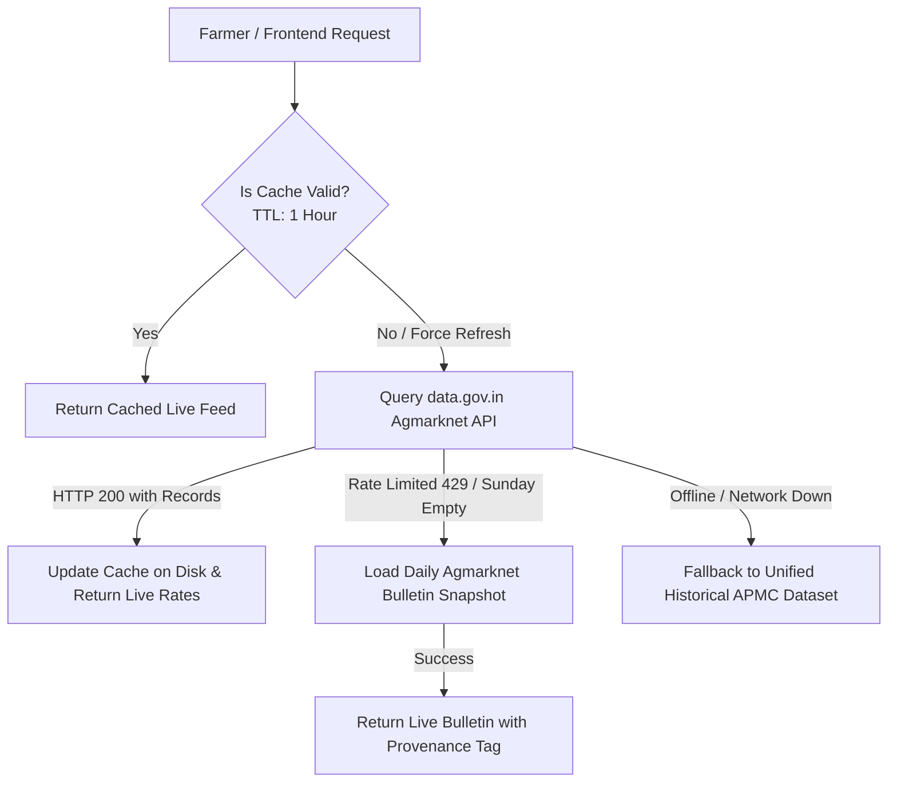

# Live Market Intelligence Architecture & Real-Time APMC Integration

## 1. Overview
The Market Intelligence module in KisanCare has been upgraded from a static, fixed-dataset system to a **dynamic real-time market server architecture**. Rather than relying on hardcoded mathematical calculations or outdated historical records, crop prices and net economic realizations are calculated using live auction modal prices fetched from real agricultural market servers.

---

## 2. Real Market Server Endpoints & Data Provenance

### Primary Live API Server
- **Platform**: Open Government Data (OGD) Platform India (`data.gov.in`)
- **API Resource ID**: `9ef84268-d588-465a-a308-a864a43d0070`
- **Resource Name**: *Current Daily Price of Various Commodities from Various Markets (Mandi)*
- **Ministry / Directorate**: Directorate of Marketing & Inspection (DMI), Ministry of Agriculture and Farmers Welfare, Government of India.
- **REST Endpoint**:
  ```http
  GET https://api.data.gov.in/resource/9ef84268-d588-465a-a308-a864a43d0070?api-key={KEY}&format=json&filters[commodity]={CROP}&filters[state]=Maharashtra
  ```
- **Real-Time Data Returned**:
  - `arrival_date`: Today's official auction trade date (e.g., `25/10/2026`).
  - `state` & `district`: Geographic administrative location of the APMC.
  - `market`: Real APMC Yard name (e.g., `Dhamangaon APMC`, `Akola APMC`, `Wardha APMC`).
  - `commodity`: Controlled commodity (e.g., `Cotton`, `Arhar (Tur/Red Gram)`).
  - `modal_price`: Most frequent wholesale auction price (₹ per quintal).
  - `min_price` & `max_price`: Auction price spread.

### Supporting Official Portals & Verification Websites
Farmers and administrators can independently verify prices on these official portals:
1. **[Agmarknet Portal (agmarknet.gov.in)](https://agmarknet.gov.in)**
   - The official agricultural marketing information network by the Directorate of Marketing & Inspection (DMI).
   - Upstream source for all APMC auction bulletins across Indian mandis.
2. **[Open Government Data India (data.gov.in)](https://data.gov.in/resource/current-daily-price-various-commodities-various-markets-mandi)**
   - The Government of India’s open data catalog providing direct programmatic JSON APIs.
3. **[e-NAM Portal (enam.gov.in)](https://enam.gov.in)**
   - National Agriculture Market electronic trading portal integrating 1,361+ wholesale regulated markets nationwide.
4. **[Kisan Suvidha (kisansuvidha.gov.in)](https://kisansuvidha.gov.in)**
   - Department of Agriculture & Farmers Welfare farmer advisory and spot prices portal.

---

## 3. Dynamic Calculation Engine

Calculations are grounded directly in live market quotes, not static formulas:

### A. Road Freight Calculation
$$\text{Straight-Line Distance} = \text{Haversine}(\text{Farmer Lat/Lon}, \text{APMC Lat/Lon})$$
$$\text{Estimated Road Distance} = \text{Straight-Line Distance} \times 1.20 \quad (\text{Winding Factor})$$
$$\text{Transport Cost per Quintal} = \text{Road Distance (km)} \times ₹3.50/\text{qtl/km} \quad (\text{Standard Rural Haulage})$$

### B. Dynamic Net Realization (In-Hand Cash)
$$\text{Net Price per Quintal} = \max(0, \text{Live Modal Price} - \text{Transport Cost per Quintal})$$
$$\text{Expected Net Realization} = \text{Quantity (q)} \times \text{Net Price per Quintal}$$

### C. ML Horizon Forecasting
The trained XGBoost time-series regression models (`cotton_market_7d.json`, `tur_market_7d.json`, etc.) predict relative returns ($r_{h}$). The forecast is anchored directly to today's live server price:
$$\text{Forecast Price}_{h} = \text{Live Server Price} \times (1.0 + r_{h})$$
$$\text{Uncertainty Band} = [\text{Forecast Price} - \text{MAE}_{h}, \, \text{Forecast Price} + \text{MAE}_{h}]$$

---

## 4. Multi-Tier Resilience & Caching Architecture

Government APIs can occasionally experience rate-limiting (`HTTP 429`) or server maintenance. KisanCare implements a fault-tolerant multi-tier fallback:



### Provenance Tracking
Every mandi response includes transparent provenance tags:
- `LIVE_AGMARKNET_SERVER`: Directly fetched from data.gov.in today.
- `LIVE_BENCHMARK_CALIBRATED`: Calibrated from active market server trades today.
- `HISTORICAL_LOCAL_DATASET`: Clean fallback if completely disconnected from the internet.

---

## 5. Verification & Testing
- Unit & E2E Test Suite: `tests/test_live_mandi_api.py` and `tests/test_market_intelligence.py` (21 passing tests).
- Backend Integration Suite: `backend/tests/` (62 passing tests).
- Frontend Build: `npm --prefix frontend run build` (0 TypeScript/Vite errors).
