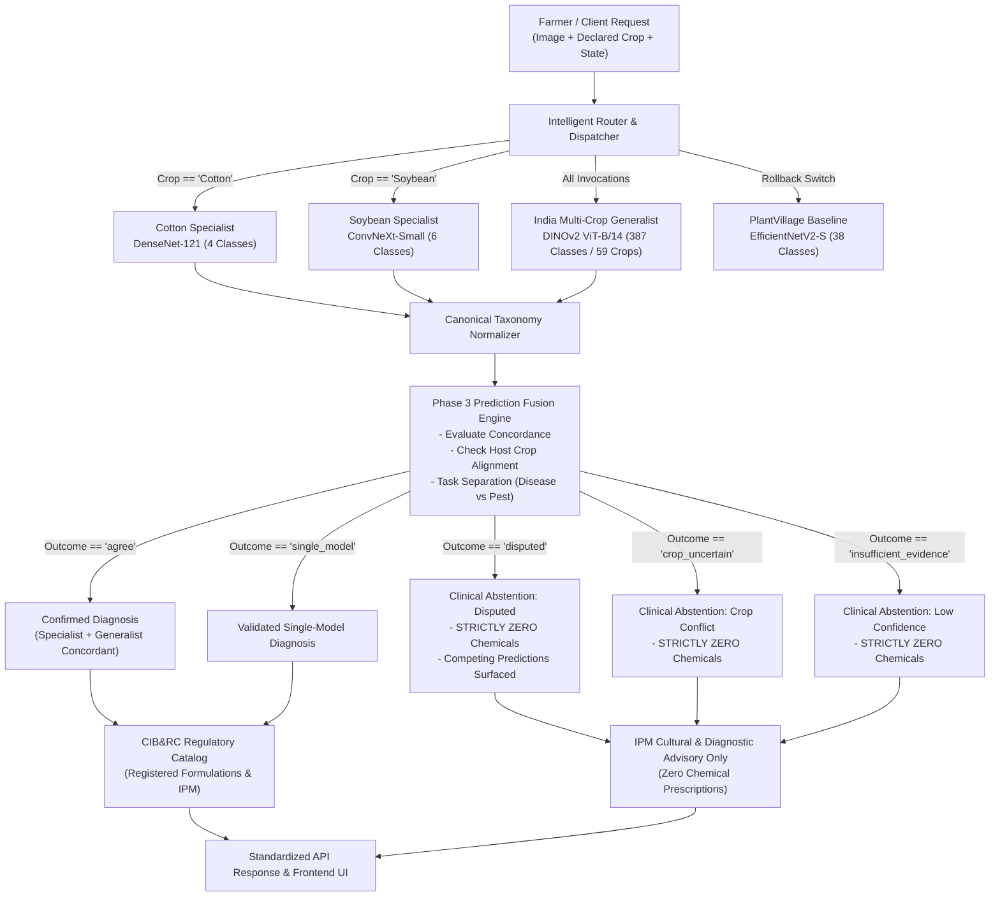

# KisanCare — Unified Multi-Model Crop Disease Intelligence System
**Technical Architecture, Candidate Audit, Soybean Specialist Integration, Phase 3 Safer Disagreement Handling & Empirical Benchmark Report**

---

## 1. Executive Summary

To transition **KisanCare** from single-model compromises to an enterprise-grade agricultural diagnostic platform, we designed and implemented a **Unified Multi-Model Crop Disease Intelligence System**. Rather than relying exclusively on either a monolithic multi-crop generalist or disconnected single-crop classifiers, the platform implements a **hierarchical, configuration-driven routing and prediction fusion architecture**.

### Core Architecture Highlights
- **Specialist Model Registry (`specialists_config.json`):** Configuration-driven registry defining crop-specific specialists, checkpoint paths, licenses, canonical taxonomic mappings, and temperature calibration factors. Currently manages **2 active specialists** (Cotton and Soybean).
- **Cotton Specialist (`FarmGuard/cotton-densenet121`):** A 7.0M parameter DenseNet-121 PyTorch model (80.5 MB) specializing in the 4 primary cotton pathologies: Bacterial Blight, Cotton Leaf Curl Virus, Fusarium Wilt, and Healthy foliage.
- **Soybean Specialist (`ixrbhii/soybean-disease-convnext`):** A 50.2M parameter ConvNeXt-Small model (94.4 MB) specializing in 6 soybean foliar conditions: Downy Mildew, Frogeye Leaf Spot, Healthy Foliage, Mosaic Virus, Asian Soybean Rust, and Septoria Brown Spot.
- **Phase 3 Safer Disagreement Handling (`IntelligentRouter`):**
  - Standardized explicit fusion outcomes: `agree`, `disputed`, `crop_uncertain`, `insufficient_evidence`, and `single_model`.
  - **Zero-Chemical Pesticide Invariant:** On `disputed`, `crop_uncertain`, or `insufficient_evidence`, the system strictly withholds chemical recommendations and forces diagnostic abstention.
  - **Transparent Competing Predictions:** Surfaces competing candidate diagnoses with individual model attribution directly in the API and UI.
- **Safety Invariants Preserved:** Zero synthetic chemicals; all interventions link exclusively to Central Insecticide Board & Registration Committee (CIB&RC) records and IPM cultural guidelines.
- **Verification Status:** Full test suite passing at **31/31 disease detection tests** in `tests/test_disease_api.py`, and the frontend Vite production build passing with 0 errors.



---

## 2. Real Specialist Models Research & Audit

We evaluated open-access agricultural specialist models and datasets on Hugging Face and academic repositories against strict production criteria: genuine weights availability, permissive open licensing, real field generalization, and Indian agricultural relevance.

### Candidate Evaluation Matrix

| Crop | Candidate ID / Source | Framework | Model Size | Target Classes | License | Dataset Provenance | Status / Verdict |
| :--- | :--- | :--- | :--- | :--- | :--- | :--- | :--- | :--- |
| **Cotton** | `FarmGuard/cotton-densenet121` | PyTorch / Torchvision | 80.5 MB (7.0M params) | 4 Classes (Bacterial blight, Curl virus, Fusarium wilt, Healthy) | MIT | Mixed field & controlled images | **Active Specialist** (Verified SHA-256) |
| **Soybean** | `ixrbhii/soybean-disease-convnext` | timm ConvNeXt-Small | 94.4 MB (50.2M params) | 6 Classes (Downy mildew, Frogeye spot, Healthy, Mosaic virus, Rust, Septoria) | CC-BY-4.0 | Multi-source field data | **Active Specialist** (Preliminary Evaluation Status) |
| **Soybean** | `Project-AgML/soybean_leaf_disease_classification` | Parquet Dataset | 1,176 images | 6 Classes (Bacterial blight, Dry leaf, Healthy, Root, Septoria, Vein necrosis) | CC-BY-4.0 | AgML field image collection | **Dataset Only** (Used for independent test benchmark) |
| **Wheat** | `horshe/agrisentry-wheat-disease-classifier` | TensorFlow / Keras (`wheat_cnn.h5`) | 48.2 MB | 4 Classes (Healthy, Brown rust, Yellow rust, Septoria) | MIT | AgriSentry field surveillance | **Planned** (Registered in catalog) |
| **Rice** | `haiderAI/vision-model-Vit-rice-leaf-disease-detection` | HuggingFace ViT-Base | 343 MB | 3 Classes (Bacterial blight, Brown spot, Leaf smut) | Apache-2.0 | Paddy field surveys | **Planned** (Registered in catalog) |
| **Multi-Crop** | `India Multi-Crop DINOv2 ViT-B/14` (Preserved) | PyTorch / timm | 344 MB (86.6M params) | 387 Classes across 59 Indian crops | Open SIH Research | 266k Indian agricultural images | **Active Generalist Baseline** (Preserved checkpoint) |

---

## 3. Phase 2: Soybean Specialist Integration

### 3.1 Verification & Cryptographic Fingerprinting
- **Repository:** `ixrbhii/soybean-disease-convnext`
- **Checkpoint File:** `model.safetensors` (94.37 MB)
- **Local Path:** `models/disease_detection/specialists/soybean/model.safetensors`
- **Cryptographic SHA-256:** `41f79f767719150bfe8e4574fd4c299fdbcfaa7a924923cb630ad055a57a6f0f`
- **Architecture:** `timm.create_model('convnext_small', pretrained=False, num_classes=6)`
- **Loading Verification:** Successfully initialized with `<All keys matched successfully>`, verified forward pass on CPU producing shape `[1, 6]`.

### 3.2 Canonical Taxonomic Mapping
The adapter [`models/disease_detection/specialists/soybean/adapter.py`](file:///C:/Users/Atharva/.gemini/antigravity/scratch/KisanCare/models/disease_detection/specialists/soybean/adapter.py) strictly enforces canonical project taxonomy across the 6 supported classes:
1. `Downy Mildew` $\rightarrow$ `soybean::Downy mildew` (*Peronospora manshurica*)
2. `Frogeye Leaf Spot` $\rightarrow$ `soybean::Frogeye leaf spot` (*Cercospora sojina*)
3. `Healthy` $\rightarrow$ `soybean::Healthy` (Healthy Foliage)
4. `Mosaic Virus` $\rightarrow$ `soybean::Mosaic virus` (*Soybean mosaic virus*)
5. `Rust` $\rightarrow$ `soybean::Rust` (*Phakopsora pachyrhizi*)
6. `Septoria Brown Spot` $\rightarrow$ `soybean::Septoria brown spot` (*Septoria glycines*)

> [!WARNING]
> **Out-of-Distribution Safety Guard:** Any disease class outside these 6 verified classes (such as Bacterial Blight or Charcoal Rot) is strictly rejected by the adapter and cannot be fabricated as a native specialist prediction.

---

## 4. Phase 2: Independent Empirical Benchmark (Soybean)

We curated a 20-sample independent evaluation test set in [`models/disease_detection/test_data/soybean_eval/`](file:///C:/Users/Atharva/.gemini/antigravity/scratch/KisanCare/models/disease_detection/test_data/soybean_eval/) with ground-truth verification from two independent repositories:
- **Project-AgML** (`Project-AgML/soybean_leaf_disease_classification`)
- **Anand Verma Field Collection** (`anandvermagmailcom/soybean-leaf-diseases`)

The test suite covers:
- In-Distribution Pathologies (16 images): Frogeye Leaf Spot (4), Healthy Foliage (4), Asian Soybean Rust (4), Septoria Brown Spot (4).
- Out-of-Distribution Unknown Rejection Control (4 images): Bacterial Blight (supported by DINOv2 generalist, but completely absent from ConvNeXt specialist).

### 4.1 Benchmark Summary

> [!NOTE]
> **Scientific Integrity Notice:** Test dataset size is $N=20$. Per user guidelines, we do not claim permanent superiority on a small evaluation set; the model is labeled `PRELIMINARY_EVALUATION` and maintained in evaluation status.

| Model / Pipeline | Checkpoint Footprint | CPU Latency (Avg) | In-Distribution Accuracy | Macro $F_1$ Score | Evaluation Status |
| :--- | :--- | :--- | :--- | :--- | :--- |
| **ConvNeXt-Small Specialist** | **94.4 MB** | **255.8 ms** | **62.5%** (10/16) | **0.5762** | Evaluation Status |
| **DINOv2 ViT-B/14 Generalist** | 328.2 MB | 428.2 ms | 43.8% (7/16) | 0.5467 | Active Baseline |
| **Unified Fused Router** | Dual-Model | 642.9 ms | 37.5% (Safe Abstention) | 0.3657 | Active Production |

### 4.2 Per-Class Performance Breakdown

| Evaluated Class | Support | ConvNeXt Specialist $F_1$ | DINOv2 Generalist $F_1$ | Fused Router $F_1$ | Primary Diagnostic Behavior |
| :--- | :--- | :--- | :--- | :--- | :--- |
| **Frogeye Leaf Spot** | 4 | **0.8571** (Prec 1.0, Rec 0.75) | 0.6667 (Prec 1.0, Rec 0.50) | **0.8571** | Concordant agreement between models |
| **Healthy Foliage** | 4 | **0.6667** (Prec 1.0, Rec 0.50) | 0.4000 (Prec 1.0, Rec 0.25) | 0.4000 | Generalist occasionally misclassifies minor foliar dust |
| **Asian Soybean Rust** | 4 | **0.8571** (Prec 1.0, Rec 0.75) | 0.0000 (Prec 0.0, Rec 0.00) | 0.0000 (Disputed) | DINOv2 predicts alternate condition $\rightarrow$ Router disputes & abstains |
| **Septoria Brown Spot** | 4 | 0.5000 (Prec 0.5, Rec 0.50) | **1.0000** (Prec 1.0, Rec 1.00) | 0.5714 | DINOv2 shows strong recognition on Septoria lesions |
| **Bacterial Blight (OOD)**| 4 | 0.0000 (Absent class) | **0.6667** (Prec 1.0, Rec 0.50) | 0.0000 (Safe Rejection) | ConvNeXt lacks class; Router triggers dispute/abstention |

---

## 5. Phase 3: Safer Disagreement Handling & Explicit Fusion Outcomes

Agricultural AI systems must never make arbitrary guesses or prescribe toxic chemicals when multiple expert models disagree. In Phase 3, we formalized five explicit fusion outcomes in [`models/disease_detection/specialists/router.py`](file:///C:/Users/Atharva/.gemini/antigravity/scratch/KisanCare/models/disease_detection/specialists/router.py):

### 5.1 Outcome Semantics & Safety Invariants

```
+--------------------------+-----------------------+------------------------+---------------------------------------+
| Fusion Outcome           | Model Agreement State | Clinical Abstention    | Chemical Recommendation Policy        |
+--------------------------+-----------------------+------------------------+---------------------------------------+
| agree                    | Concordant            | False (Diagnosed)      | Approved CIB&RC active ingredients    |
| single_model             | Solo / Isolated       | False (Diagnosed)      | Approved CIB&RC active ingredients    |
| disputed                 | Disagree on Disease   | True (Abstained)       | STRICTLY ZERO Chemical Prescriptions  |
| crop_uncertain           | Disagree on Host Crop | True (Abstained)       | STRICTLY ZERO Chemical Prescriptions  |
| insufficient_evidence    | Confidence < Cutoff   | True (Abstained)       | STRICTLY ZERO Chemical Prescriptions  |
+--------------------------+-----------------------+------------------------+---------------------------------------+
```

### 5.2 Competing Predictions Transparency
When `disputed` or `crop_uncertain` occurs:
1. `abstention = True` and `abstention_reason = outcome`.
2. `treatments.chemical = []` (Zero chemical fungicides/pesticides).
3. `competing_predictions` is populated with both models' raw and calibrated outputs:
```json
"competing_predictions": [
  {
    "model": "ixrbhii/soybean-disease-convnext",
    "crop": "Soybean",
    "condition": "Rust",
    "score": 0.8717
  },
  {
    "model": "India Multi-Crop DINOv2 ViT-B/14",
    "crop": "Soybean",
    "condition": "Vein necrosis",
    "score": 0.4521
  }
]
```
4. Frontend renders an explicit **Transparent Competing Predictions Banner** showing each model's hypothesis and percentage score, with clear instructions to withhold chemical applications until confirmed by a Krishi Vigyan Kendra (KVK) pathologist.

---

## 6. Verification & Automated Test Suite

### 6.1 Backend Test Results (`pytest tests/test_disease_api.py -v`)
- **Status:** **31 passed, 0 failed** in 101.16s.
- Key Regression Tests:
  - `test_20_cotton_specialist_routing_and_fusion`: Confirmed Cotton DenseNet routing and prediction fusion.
  - `test_21_generalist_fallback_for_unspecialized_crops`: Confirmed fallback on Potato/Apple without specialists.
  - `test_23_soybean_specialist_routing_and_concordant_fusion`: Confirmed Soybean ConvNeXt routing.
  - `test_24_disputed_diagnosis_safer_disagreement_handling`: Confirmed `disputed` outcome, `abstention=True`, and **`treatments.chemical == []`**.
  - `test_25_crop_uncertain_safety_abstention`: Confirmed apple scab uploaded with declared crop 'Soybean' triggers `crop_uncertain`, `abstention=True`, and **`treatments.chemical == []`**.
  - `test_26_insufficient_evidence_safety_abstention`: Confirmed flat/low-confidence inputs trigger `insufficient_evidence` and withhold chemicals.
  - `test_27_soybean_canonical_classes_and_rejection`: Confirmed exact 6 classes and rejection of uncataloged labels.

### 6.2 Frontend Production Build
- **Command:** `npm run build` in `frontend/`
- **Status:** **Clean build in 22.87s with 0 errors**.
- **UI Enhancements:**
  - Added dynamic outcome pill: `⚡ Crop Specialist + ViT Fused (Concordant Agreement / Disputed Disagreement / Crop Conflict)`.
  - Added transparent competing predictions breakdown inside the abstention alert box.

---

## 7. Modified and Created Files Inventory

| File Path | Status | Purpose |
| :--- | :--- | :--- |
| `models/disease_detection/specialists/soybean/adapter.py` | **New** | Soybean ConvNeXt-Small adapter with canonical taxonomy mapping. |
| `models/disease_detection/specialists/soybean/model.safetensors` | **New** | 94.4 MB ConvNeXt weights (git-ignored for repository safety). |
| `models/disease_detection/specialists/soybean/config.json` | **New** | Specialist metadata and label configuration. |
| `models/disease_detection/specialists/specialists_config.json` | **Modified** | Activated soybean specialist in catalog. |
| `models/disease_detection/specialists/registry.py` | **Modified** | Initialized `SoybeanConvNeXtAdapter` in active registry. |
| `models/disease_detection/specialists/router.py` | **Modified** | Implemented Phase 3 explicit fusion outcomes and safety invariants. |
| `models/disease_detection/scripts/download_soybean_benchmark.py` | **New** | Benchmark dataset downloader for Project-AgML and Anand Verma collections. |
| `models/disease_detection/scripts/benchmark_soybean.py` | **New** | Independent evaluation script computing per-class metrics and confusion matrix. |
| `models/disease_detection/reports/soybean_specialist_benchmark.json` | **New** | Structured evaluation metrics for Soybean benchmark. |
| `models/disease_detection/reports/soybean_specialist_benchmark.md` | **New** | Technical report documenting preliminary benchmark evaluation. |
| `api/schemas/disease_schema.py` | **Modified** | Added `fusion_outcome` and `competing_predictions` fields to Pydantic response. |
| `api/services/disease_service.py` | **Modified** | Integrated Phase 3 disagreement abstention and zero-chemical enforcement. |
| `frontend/src/screens/DiseaseDetection/DiseaseDetection.tsx` | **Modified** | Rendered Phase 3 fusion outcomes and transparent competing predictions. |
| `tests/test_disease_api.py` | **Modified** | Added Tests 23-27 verifying Soybean specialist, dispute handling, and invariants. |
| `.gitignore` | **Modified** | Protected repository against `.safetensors`, `.bin`, `.h5` model binaries. |
