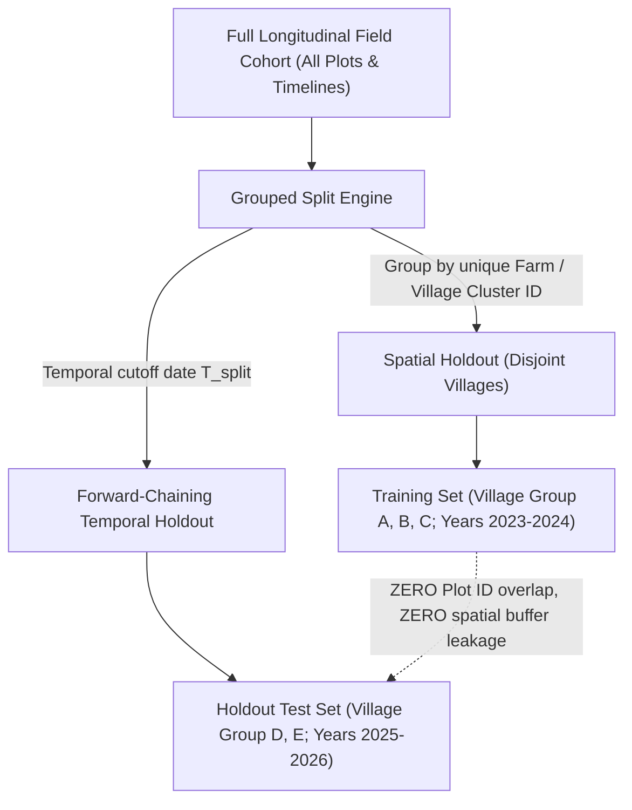

# KISANcare Soil Intelligence — Leakage-Safe Validation Protocol

> **DOCUMENT STATUS**: Official Model Evaluation Specification  
> **CURRENT VALIDATION STATUS**: `NOT_YET_VALIDATED` / `BLOCKED` (Awaiting genuine longitudinal ground truth)  
> **RULE**: All tolerance thresholds remain strictly `PROVISIONAL_PENDING_EXPERT_APPROVAL`. Do NOT claim the 80% target has been achieved until verified under this protocol.

---

## 1. Prediction Targets & Laboratory Measurement Basis

Predictions must target the exact laboratory-extractable available nutrient pool—**never** the cumulative mass-balance flux or total elemental content of the soil profile:

| Nutrient | Target Parameter | Measurement Protocol | Reporting & Standard Units |
| :--- | :--- | :--- | :--- |
| **Nitrogen ($N$)** | Alkaline Permanganate Available $N$ | Subbiah & Asija (1956) alkaline $0.32\%\text{ KMnO}_4 + 2.5\%\text{ NaOH}$ steam distillation | Standardized elemental $N$ in $\text{kg/ha}$ (0–15 cm depth) |
| **Phosphorus ($P$)** | Olsen Extractable Available $P$ | Olsen et al. (1954) $0.5\text{M NaHCO}_3$ ($\text{pH } 8.5$), ascorbic acid reduction | Standardized elemental $P$ in $\text{kg/ha}$ (converted from $P_2O_5$ via factor $0.43642$) |
| **Potassium ($K$)** | Neutral Ammonium Acetate Available $K$ | Hanway & Heidel (1952) neutral normal $1\text{N NH}_4\text{OAc}$ ($\text{pH } 7.0$) flame photometry | Standardized elemental $K$ in $\text{kg/ha}$ (converted from $K_2O$ via factor $0.83016$) |

---

## 2. Prediction Horizon & Operating Conditions

1. **Horizon Range**: Single-season ($6\text{ months}$) to multi-year ($36\text{ months}$) progression following an initial accredited laboratory test.
2. **Valid Operating Range**:
   - Soil reaction: $5.5 \le \text{pH} \le 8.8$ (mineral agricultural soils).
   - Electrical conductivity: $\text{EC} \le 4.0\text{ dS/m}$ (non-saline agricultural topsoils).
   - Topsoil layer: Standard agricultural root zone ($0–15\text{ cm}$).
3. **Operating Conditions**:
   - Vertisols (black soils), Inceptisols, and Alfisols of Central and Western India.
   - Rainfed and semi-irrigated cropping systems (Soybean, Cotton, Pigeonpea, Chickpea, Sorghum, Wheat).

---

## 3. Leakage Prevention: Grouping & Holdout Strategies

Data leakage is the most common cause of overstated model performance in spatial-temporal agricultural ML. The following holdout rules are mandatory:

### A. Grouped Plot-Level Partitioning
- **Strict Grouping by `farm_id` / `plot_id`**: All time points ($t_1, t_2, t_3, \dots$) from a single physical plot or contiguous farm holding **must belong exclusively to the training set OR exclusively to the holdout test set**.
- **Random K-Fold Cross-Validation is FORBIDDEN**: Shuffling individual time points from the same plot into both training and validation creates severe spatial-temporal autocorrelation leakage, inflating accuracy scores.

### B. Spatial Cluster Buffering
- A spatial exclusion buffer of **$\ge 2.0\text{ km}$** must separate test plots from training plots to prevent micro-climatic and soil-series cross-leakage.

### C. Forward-Chaining Temporal Holdout
- Evaluation must follow a forward temporal split: Models trained on histories prior to date $T_{\text{split}}$ (e.g., up to Kharif 2024) are evaluated on future target dates (Rabi 2024–2025 and 2025+). Backward temporal extrapolation is forbidden.

---

## 4. Benchmark Baseline Comparison

The empirical ML model must demonstrate statistically significant improvement over two standard reference baselines:
1. **Persistence Baseline ($\hat{y}_{t_2} = y_{t_1}$)**: The measured value from the baseline test report is used as the future prediction (assumes zero change).
2. **Standard Mass-Balance Buffer Heuristic**: A simple agronomic ledger without ML adjustments.

---

## 5. Quantitative Evaluation Metrics & 80% Tolerance Definition

Evaluation must report metrics independently for Nitrogen, Phosphorus, and Potassium across all holdout samples ($N_{\text{eval}}$):

### A. Primary Performance Metrics
1. **Mean Absolute Error (MAE)**:
   $$\text{MAE} = \frac{1}{N_{\text{eval}}} \sum_{i=1}^{N_{\text{eval}}} |\hat{y}_i - y_i|$$
2. **Root Mean Squared Error (RMSE)**:
   $$\text{RMSE} = \sqrt{\frac{1}{N_{\text{eval}}} \sum_{i=1}^{N_{\text{eval}}} (\hat{y}_i - y_i)^2}$$
3. **Mean Signed Difference (Bias)**:
   $$\text{Bias} = \frac{1}{N_{\text{eval}}} \sum_{i=1}^{N_{\text{eval}}} (\hat{y}_i - y_i)$$
4. **Tolerance Pass Rate ($\%$)**:
   $$\text{Within-Tolerance Rate} = \left( \frac{\sum_{i=1}^{N_{\text{eval}}} \mathbb{I}(\text{within\_tolerance}_i)}{N_{\text{eval}}} \right) \times 100\%$$

### B. Provisional Nutrient Tolerances & Evaluation Rule
A prediction is counted as within tolerance if:
$$\text{within\_tolerance}_i \iff |\hat{y}_i - y_i| \le \text{AbsTol} \quad \text{OR} \quad \frac{|\hat{y}_i - y_i|}{y_i} \times 100\% \le \text{RelTol\%}$$

| Nutrient | Target Unit | Absolute Tolerance ($\text{AbsTol}$) | Relative Tolerance ($\text{RelTol\%}$) | Acceptance Rule | Current Status |
| :--- | :--- | :--- | :--- | :--- | :--- |
| **Nitrogen ($N$)** | $\text{kg/ha}$ | $\pm 25.0\text{ kg/ha}$ | $\pm 15.0\%$ | `max_of_absolute_or_relative` | `PROVISIONAL_PENDING_EXPERT_APPROVAL` |
| **Phosphorus ($P$)** | $\text{kg/ha}$ elemental $P$ | $\pm 5.0\text{ kg/ha}$ ($11.5\text{ kg } P_2O_5$) | $\pm 20.0\%$ | `max_of_absolute_or_relative` | `PROVISIONAL_PENDING_EXPERT_APPROVAL` |
| **Potassium ($K$)** | $\text{kg/ha}$ elemental $K$ | $\pm 30.0\text{ kg/ha}$ ($36.1\text{ kg } K_2O$) | $\pm 15.0\%$ | `max_of_absolute_or_relative` | `PROVISIONAL_PENDING_EXPERT_APPROVAL` |

> [!WARNING]
> The target release threshold requires $\ge 80.0\%$ of independent test holdouts to fall within tolerance for **ALL THREE** nutrients simultaneously ($N \ge 80\%$, $P \ge 80\%$, $K \ge 80\%$). A strong score in Potassium cannot compensate for a weak score in Phosphorus.

---

## 6. Treatment of Missing Ground Truth, Outliers & Abstentions

1. **Abstentions Are NOT Scored as Correct**:
   - When the predictor abstains (`INSUFFICIENT_DATA`), the prediction is counted under **Abstention Coverage Rate**:
     $$\text{Coverage Rate} = \frac{N_{\text{predicted}}}{N_{\text{total\_queries}}} \times 100\%$$
   - The $80\%$ tolerance pass rate must be computed over the predicted subset ($N_{\text{predicted}}$), but the model is rejected if the overall coverage rate is $< 70\%$ under supported operating conditions.
2. **Missing Follow-up Lab Test ($t_2$)**:
   - If a plot has baseline $t_1$ and farm events but lacks physical lab measurement at $t_2$, it **cannot** be used for evaluation. It cannot be imputed with model predictions.
3. **Outliers & Extreme Analytical Residuals**:
   - Field samples with verified laboratory analytical errors (e.g., transcription typo on paper certificate) must be audited by a human agronomist and documented before exclusion. No outlier may be silently pruned.

---

## 7. Uncertainty Calibration Evaluation

Uncertainty intervals $[\hat{y}_{\text{lower}}, \hat{y}_{\text{upper}}]$ cannot be claimed as calibrated without empirical verification:
1. **Empirical Coverage of Uncertainty Interval**:
   - For an advertised $90\%$ prediction interval, exactly $88\%\text{ to }92\%$ of physical ground-truth holdouts must fall inside the bounds:
     $$\text{Empirical Coverage} = \frac{1}{N_{\text{eval}}} \sum_{i=1}^{N_{\text{eval}}} \mathbb{I}(\hat{y}_{\text{lower}, i} \le y_i \le \hat{y}_{\text{upper}, i})$$
2. **Sharpness (Interval Width)**:
   - Evaluated as the mean interval width ($\text{kg/ha}$). An uninformative interval of $[0, 1000\text{ kg/ha}]$ achieves 100% coverage but has zero agronomic value.
3. **Calibration Status Label**:
   - Until empirical coverage is demonstrated on independent test sets, all uncertainty outputs must retain the label `UNCALIBRATED_HEURISTIC_BOUND`.

---

## 8. Governance: Expert Ratification & Operational Release Gate

Before the model scope can transition from `BLOCKED` to `VALIDATED_FOR_SCOPE`, the following sign-off protocol is legally and scientifically required:

### A. Agronomic Review Board Sign-Off
- **Approving Authority**: Formal ratification from a recognized panel comprising:
  1. Senior Soil Scientist / Agronomist from a State Agricultural University (MPKV Rahuri or VNMKV Parbhani).
  2. ICAR Soil Fertility Specialist.
  3. Lead Agronomist, KISANcare.
- **Review Scope**: Ratification of the numerical tolerance values ($\pm 25\text{ kg/ha N}$, $\pm 5\text{ kg/ha P}$, $\pm 30\text{ kg/ha K}$) to confirm they do not cause harmful over- or under-fertilization.

### B. Minimum Evidence Checklist for `VALIDATED_FOR_SCOPE`
- [ ] `DatasetAuditReport`: Status `PASSED`, genuine accredited laboratory provenance, verified longitudinal pairing on identical plots ($N \ge 165$ holdout pairs).
- [ ] Leakage-Safe Holdout: `GROUPED_PLOT_TIME_SERIES` split with spatial cluster isolation.
- [ ] Accuracy Threshold: Nitrogen $\ge 80\%$, Phosphorus $\ge 80\%$, Potassium $\ge 80\%$ within tolerance on unseen holdouts.
- [ ] Uncertainty Calibration: Empirical coverage matches nominal level ($\pm 3\%$).
- [ ] Formal Evidence Bundle: Signed [`ValidationEvidenceBundle`](file:///c:/Users/prana/Downloads/KISANcare/KISANcare/kisan-care/ml/soil_intelligence/model/validation_gate.py) with immutable cryptographic hash of the evaluation code and dataset.
- [ ] Official Ratification: `tolerance_signoff_status` set to `OFFICIALLY_RATIFIED`.

**Zero exceptions or manual bypasses are permitted.**
